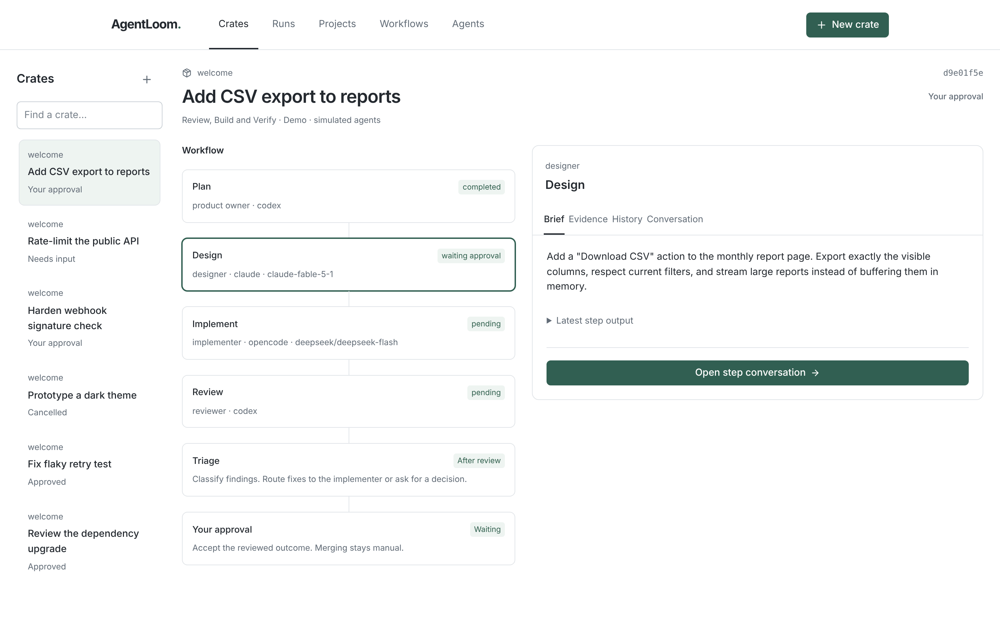
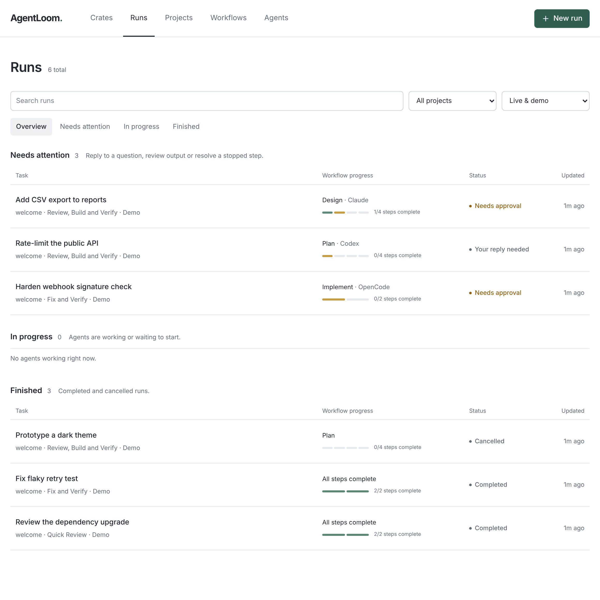
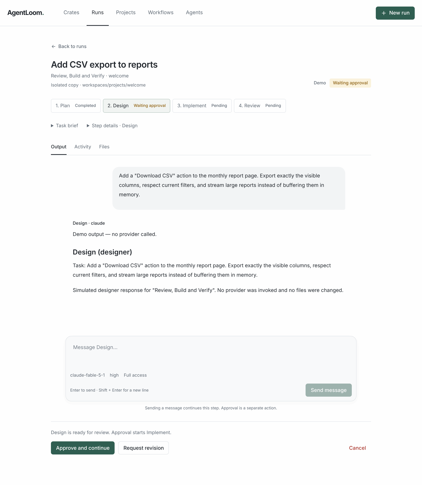
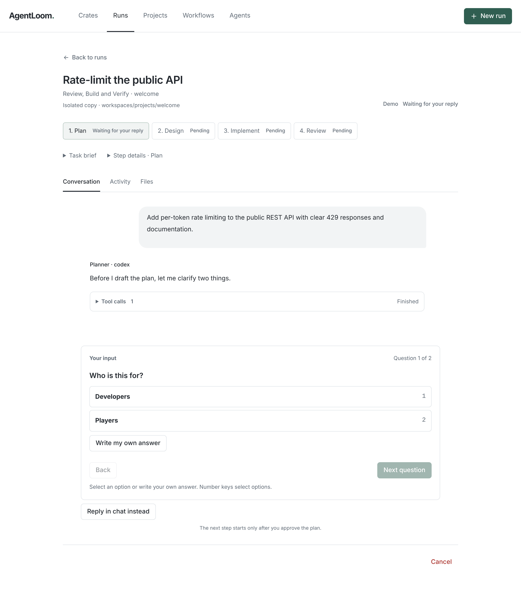
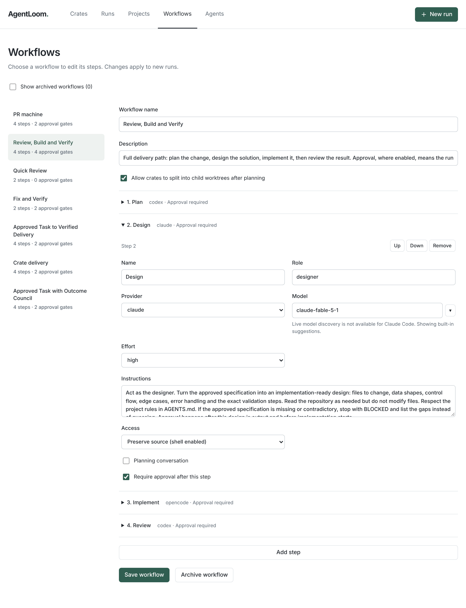
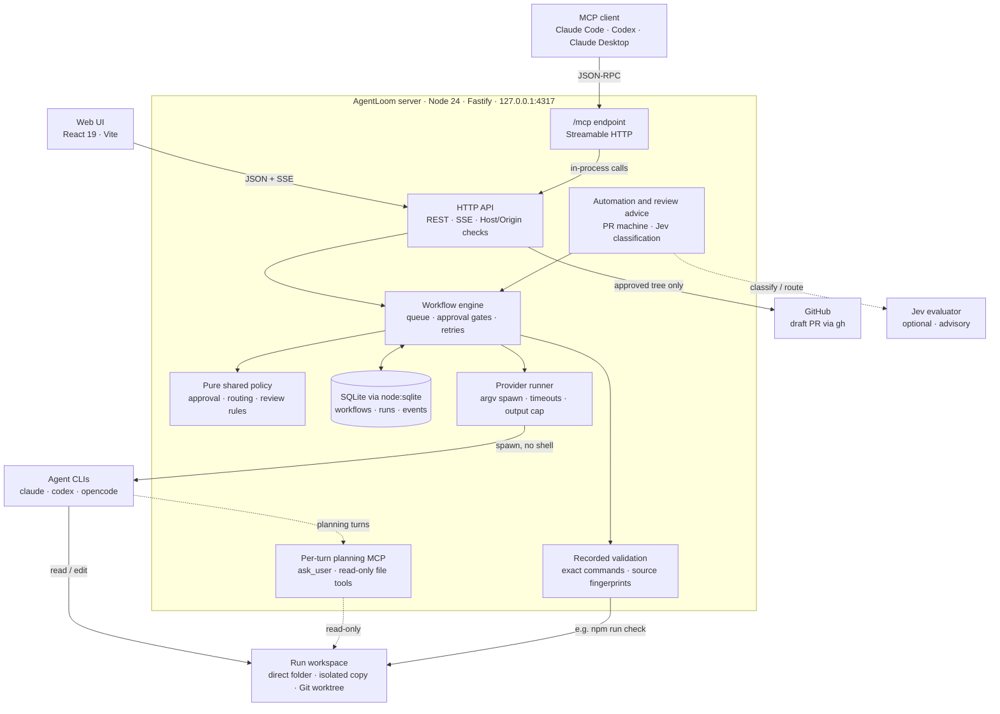
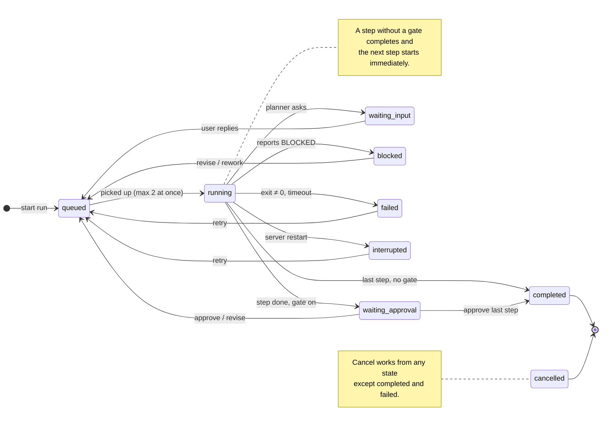
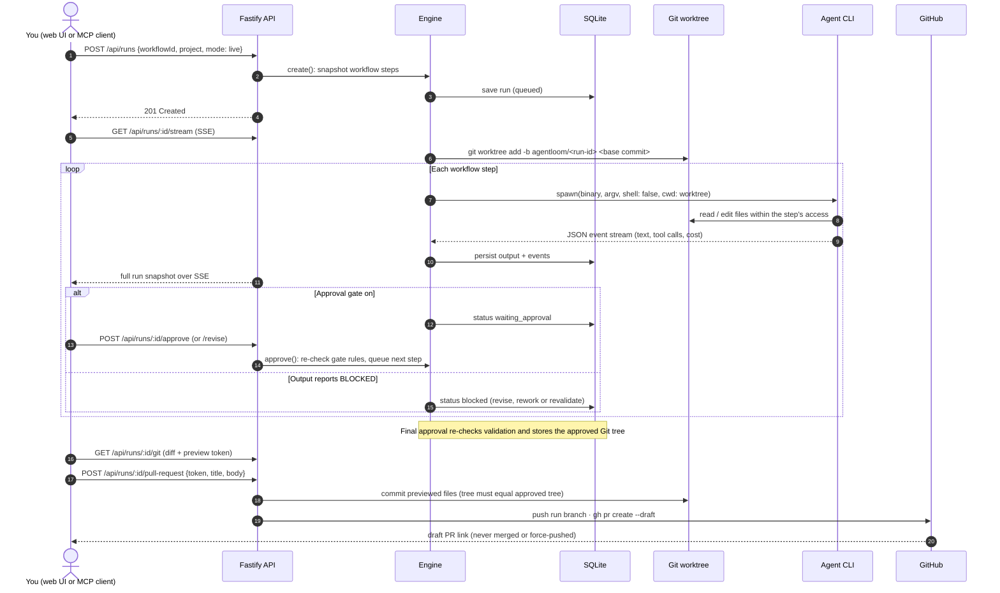

# AgentLoom

[](https://github.com/Animii/AgentLoom/actions/workflows/validation.yml)


**Run Claude Code, Codex and OpenCode as one reviewable workflow: multi-step agent pipelines with human approval gates, recorded validation and draft-PR delivery, on your own machine.**

Coding agents are good at a single task; the handoffs are where things slip. A planner invents a missing requirement, an implementer reports that tests pass, a reviewer's blocker gets lost between sessions. AgentLoom makes every handoff explicit: each step runs a real agent CLI in a controlled workspace, its output and events are persisted, and the next agent starts only after you approve, revise or stop it.



<sub>Demo mode, captured from the real UI. Each step shows its role and agent; the run is paused at the Design gate.</sub>

**At a glance:** TypeScript end to end (Node 24, Fastify, React 19) · 3 agent CLIs · 7 built-in workflows · 16 MCP tools · SQLite via `node:sqlite` · 196 backend tests + 31 Playwright browser tests in CI.

## Contents

- [Features](#features)
- [Screenshots](#screenshots)
- [How it works](#how-it-works)
- [Quickstart](#quickstart)
- [Drive AgentLoom from an MCP client](#drive-agentloom-from-an-mcp-client)
- [Configuration](#configuration)
- [Project structure](#project-structure)
- [Tech stack](#tech-stack)
- [Testing and CI](#testing-and-ci)
- [Design decisions and trade-offs](#design-decisions-and-trade-offs)
- [Limitations](#limitations)
- [Documentation](#documentation)

## Features

- **Multi-agent workflows.** Define steps with a role, provider (Claude Code, Codex or OpenCode), model, effort, instructions and access level. Seven templates ship, from a two-step read-only review to plan → design → implement → review.
- **Approval gates.** A gated step pauses _after_ it produces output and _before_ the next agent starts. Approve, request a revision with feedback, or cancel. Failures wait for an explicit retry, nothing is approved automatically unless you opt a run into the PR machine, and an output that starts with `BLOCKED` can never be approved.
- **Planning conversations with an `ask_user` tool.** Planners get a per-turn MCP server with `ask_user` plus read-only `list_project_files`, `read_project_file` and `search_project`. Questions appear as a structured panel; the plan only moves on when you approve it.
- **Three workspace modes.** Work directly in a folder, in an isolated copy, or in a **Git worktree per run** on branch `agentloom/<run-id>`, created from a managed bare repository so your checkout is untouched.
- **Draft PRs of exactly what you approved.** Final approval records the Git tree; publishing re-checks it, pushes only the run branch and opens a draft with `gh`. It never force-pushes or merges.
- **Recorded validation.** Validation steps run configured commands themselves (no shell), record exit codes, bounded output and source fingerprints, and block final approval if checks fail or the source changed afterwards.
- **MCP server for other agents.** `/mcp` exposes 16 `agentloom_*` tools so Claude Code, Codex or another MCP client can start runs, answer gates, read diffs and publish PRs through the same rules as the UI.
- **Live, restart-safe runs.** Output streams over server-sent events. On restart, in-flight runs become `interrupted` and wait for an explicit retry; pending approvals and planner questions survive.
- **Demo mode.** Simulated agents walk the full flow, including planner questions and approval gates, without credentials, CLIs or file changes.
- **Opt-in delivery modes.** An outcome council (three independent reviewers plus a chair), a PR machine that routes up to two repairs through an advisory evaluator, and crates that split approved plans into child worktrees. See the [user guide](docs/USER_GUIDE.md).

## Screenshots

| Runs grouped by what needs you                                                                       | An approval gate                                                                                                              |
| ---------------------------------------------------------------------------------------------------- | ----------------------------------------------------------------------------------------------------------------------------- |
|  |  |
| **Planner questions via the `ask_user` MCP tool**                                                    | **Per-step provider, model, effort, access and gate**                                                                         |
|       |                                              |

All screenshots are from demo mode, so outputs are placeholders and no provider was called.

## How it works

### Architecture

One Node process serves the React UI, the JSON API, server-sent events and the MCP endpoint, bound to `127.0.0.1`. The engine owns the run queue and gates; everything with side effects (SQLite, agent processes, workspaces, Git, validation, the evaluator) sits behind small application-owned ports that tests replace with fakes.



ESLint enforces the boundaries: the client cannot import server code, shared policy cannot import adapters or Node I/O, and the engine cannot import concrete adapters. See [Architecture](docs/ARCHITECTURE.md).

### Run lifecycle

States and transitions come from `RunStatus` in [`src/shared/types.ts`](src/shared/types.ts) and the engine in [`src/server/engine.ts`](src/server/engine.ts).



The server re-checks every gate on approval. It refuses while:

| Guard                    | Why                                                                                            |
| ------------------------ | ---------------------------------------------------------------------------------------------- |
| Output reports `BLOCKED` | Agents are told to stop instead of inventing missing requirements; that stop must be resolved. |
| Planner questions open   | A plan cannot be approved while the planner is still waiting for answers.                      |
| Validation stale/failing | Final approval needs passing recorded checks on an unchanged source fingerprint.               |
| Uncertain Jev assessment | Low-confidence review advice must be acknowledged explicitly; stale acknowledgments fail.      |
| Run changed meanwhile    | Final approval compares a snapshot of the run before and after computing the Git preview.      |

### One live run, end to end

A run of _Review, Build and Verify_ on a Git-worktree project, from the web UI or an MCP client:



Direct-folder and isolated-copy runs skip the Git steps; demo runs skip the agent CLIs entirely.

## Quickstart

### Docker Compose (recommended)

The image bundles the server, the three agent CLIs (Claude Code, Codex, OpenCode), `git`, `gh` and the Docker CLI. Requires Docker with Linux containers.

```sh
git clone https://github.com/Animii/AgentLoom.git
cd AgentLoom
docker compose up -d --build --wait
```

Open **http://localhost:4317**. Compose publishes only on `127.0.0.1`. By default it also mounts the clone's parent directory read/write as the root for **Connect folder**; set `PROJECTS_FOLDER` in `.env` to narrow that.

### Node 24, without Docker

Demo mode needs no agent CLIs. For live runs, install `claude`, `codex` and/or `opencode` on your `PATH` (or point `CLAUDE_BIN`, `CODEX_BIN`, `OPENCODE_BIN` at them).

```sh
npm ci --include=dev
npm run build
npm start            # http://127.0.0.1:4317, data in ./.data and ./workspaces
```

For hot reload, run `npm run dev` (API) and `npm run dev:web` (Vite on port 5173, proxying `/api`) in two terminals.

### Try the demo

1. Choose **New run**, keep the auto-created **welcome** project, pick **Review, Build and Verify** and set **Mode** to **Demo**.
2. The simulated planner asks two questions. Answer them, then **Approve plan and continue**.
3. Each gated step stops at **Approve and continue / Request revision / Cancel**. Watch the run move between _Needs attention_, _In progress_ and _Finished_ on **Runs**.

Live runs call your configured providers and may incur charges. To connect providers in Docker, log in inside the container (credentials persist in the `agent_home` volume) or set API keys in `.env`:

```sh
docker compose exec platform claude auth login
docker compose exec platform codex login --device-auth
docker compose exec platform opencode auth login
```

The [user guide](docs/USER_GUIDE.md) covers projects, worktrees, draft PRs, planning conversations, validation, the council and the PR machine.

## Drive AgentLoom from an MCP client

The server exposes a Streamable HTTP MCP endpoint at `http://127.0.0.1:4317/mcp`. Add it to Claude Code:

```sh
claude mcp add --transport http agentloom http://127.0.0.1:4317/mcp
```

or check it into a project as `.mcp.json`:

```json
{
  "mcpServers": {
    "agentloom": {
      "type": "http",
      "url": "http://127.0.0.1:4317/mcp"
    }
  }
}
```

For Codex, add the same URL to `~/.codex/config.toml` (these are the keys AgentLoom itself passes to Codex for its planning tools):

```toml
[mcp_servers.agentloom]
url = "http://127.0.0.1:4317/mcp"
```

Then ask your agent something like _"List AgentLoom workflows and projects, start a demo run of Review, Build and Verify on the welcome project, and tell me what it is waiting for."_

| Area      | Tools (`agentloom_` prefix)                                                                              |
| --------- | -------------------------------------------------------------------------------------------------------- |
| Workflows | `list_workflows`, `save_workflow`, `list_providers`                                                      |
| Projects  | `list_projects`, `browse_project_folders`, `connect_project`, `update_project`                           |
| Runs      | `search_runs`, `get_run`, `start_run`, `respond_to_run` (approve, revise, reply, retry, …), `cancel_run` |
| Results   | `list_run_files`, `read_run_file`, `get_run_diff`, `publish_pull_request`                                |

Every tool calls the HTTP API in-process (`app.inject`), so validation, approval rules and state checks are identical to the UI. Publishing requires the `preview_token` from `get_run_diff`, so the PR contains exactly the previewed files. Tools carry read-only/destructive annotations, and responses are bounded. Like the rest of the API, the endpoint is loopback-only with Host/Origin checks and **no authentication**: anything that can reach it can act as you.

## Configuration

Copy `.env.example` to `.env` for Docker Compose. All variables are optional.

| Variable                                                  | Default           | Purpose                                                                                             |
| --------------------------------------------------------- | ----------------- | --------------------------------------------------------------------------------------------------- |
| `ANTHROPIC_API_KEY`, `OPENAI_API_KEY`, `DEEPSEEK_API_KEY` | empty             | Provider keys if you do not use CLI logins. `OPENAI_API_KEY` is passed to Codex as `CODEX_API_KEY`. |
| `TYPESAFE_API_KEY`                                        | empty             | Fallback key for the optional Jev evaluator (can also be saved, encrypted, in the UI).              |
| `PORT`                                                    | `4317`            | HTTP port (Compose publishes it on `127.0.0.1` only).                                               |
| `WORKSPACE_ROOT`                                          | `./workspaces`    | Host directory for `projects/` and per-run `runs/` workspaces.                                      |
| `PROJECTS_FOLDER`                                         | `..`              | Host parent directory the **Connect folder** browser may use (mounted at `/host-projects`).         |
| `CLI_TIMEOUT_MS`                                          | `3600000` (1 h)   | Total runtime per agent turn (max 24 h).                                                            |
| `CLI_IDLE_TIMEOUT_MS`                                     | `600000` (10 min) | Fail a turn with no output while no tool is running; `0` disables.                                  |
| `MAX_OUTPUT_BYTES`                                        | `2097152` (2 MiB) | Captured bytes per agent process. Keep it finite; raise to e.g. `8388608` for large tasks.          |

Server-only variables (set by the Dockerfile and Compose, useful for `npm start`): `DATA_DIR` (default `./.data`), `HOST` (default `127.0.0.1`), `PROJECTS_ROOT` / `PROJECTS_HOST_ROOT`, and `CLAUDE_BIN` / `CODEX_BIN` / `OPENCODE_BIN`.

## Project structure

```text
src/
  client/            React UI: run overview, run detail, crates, workflow editor, projects, agents
  server/
    index.ts         config from env, startup and graceful shutdown
    app.ts           Fastify composition root: routes, Host/Origin checks, CSP, wiring
    engine.ts        run queue, step execution, approval/revision/retry/cancel transitions
    engine-runtime.ts  binds real adapters to the engine's ports
    ports/           application-owned repository and execution contracts
    store.ts         SQLite repository (node:sqlite, WAL)
    provider-process.ts, provider-stream.ts   spawn and parse Claude Code / Codex / OpenCode
    mcp.ts           external MCP endpoint (16 tools)
    ask-tool.ts, project-tools.ts             per-turn planning MCP server
    workspaces.ts, projects.ts, git-workspaces.ts   folders, copies, worktrees, draft PRs
    validation.ts, council.ts, automation.ts, jev.ts   evidence, reviews, routing, evaluator
  shared/            pure policy and types shared by client and server
tests/
  *.test.ts          Node test runner: unit, engine, adapter-contract and HTTP/MCP tests
  ui/*.spec.ts       Playwright suite against a disposable app with fake services
  helpers/           app fixture, scripted agents, in-memory repository, fake effects
docs/                user guide, architecture, testing, validation and pilot reports
scripts/             live experiments and pilot harnesses (not part of default tests)
```

## Tech stack

| Layer       | Choice                                                                                              |
| ----------- | --------------------------------------------------------------------------------------------------- |
| Runtime     | Node 24, TypeScript 5.9 with `strict`, ES modules                                                   |
| Server      | Fastify 5, Zod 4 strict schemas, server-sent events, `@modelcontextprotocol/server` 2               |
| Persistence | SQLite through the built-in `node:sqlite` (WAL), JSON documents per workflow/run                    |
| UI          | React 19, Vite 8, lucide-react, Streamdown for streamed Markdown                                    |
| Agents      | Claude Code, Codex and OpenCode CLIs (pinned versions in the `Dockerfile`), `git`, `gh`             |
| Quality     | ESLint `strictTypeChecked` with custom import-boundary rules, Prettier, `node:test`, c8, Playwright |
| Packaging   | Multi-stage Dockerfile, Docker Compose with healthcheck, non-root `node` user                       |

## Testing and CI

```sh
npm run check     # format:check → lint → typecheck → test → build (what CI runs)
npm run test:ui   # build, then the Playwright suite against a disposable app
```

- **196 backend tests** (`node:test`) cover the engine's state transitions, approval guards, retries, restart recovery, provider stream parsing, real subprocess handling (timeouts, output caps, cancellation), HTTP/Host/Origin validation, the MCP tools, SQLite and Git adapter contracts.
- **31 browser tests** (Playwright) run against a freshly built app with fake providers: gated revisions, planner questions, streaming, worktrees and draft PRs (against a fake GitHub), council, crates, mobile layout.
- Default tests never call a real provider, Jev or GitHub; unexpected external calls fail the test.
- [GitHub Actions](.github/workflows/validation.yml) runs `npm run check` and the browser suite on every push and pull request, without credentials.

More in [Testing](docs/TESTING.md) and [Development](docs/DEVELOPMENT.md).

## Design decisions and trade-offs

- **Drive the vendor CLIs instead of calling model APIs.** Claude Code, Codex and OpenCode already have tool loops, auth and permission models. AgentLoom orchestrates them and normalises their three JSON stream formats. The cost is coupling to CLI flags and output formats, so CLI versions are pinned in the image.
- **Humans approve; models advise.** Evaluator scores, council reports and agent claims never approve a step on their own. The one automated path, the opt-in PR machine, is authorized by a human at plan approval and capped at two repairs. Validation is executed and recorded by the platform rather than reported by the model, and `BLOCKED` is a first-class outcome rather than an error.
- **Pure policy behind ports.** Workflow decisions are pure functions; SQLite, processes, Git and HTTP live behind small ports wired at one composition root. Policy tests need no database, CLI or network, and app tests swap in scripted agents and fake external services. ESLint rules keep the boundaries from eroding.
- **SQLite via `node:sqlite`, JSON documents.** No native modules or migration framework; a run is one JSON document plus an event log. Trade-off: no relational queries over run internals, and SSE sends full run snapshots (idempotent on reconnect, heavier on the wire).
- **One API, two front doors.** The MCP endpoint calls the HTTP API in-process instead of reimplementing actions, so the UI and agents share validation and state rules.
- **Fail loudly, retry explicitly.** Non-zero exits, malformed streams, empty output and truncation fail the step. Restarts mark work `interrupted`. Retries, revisions and repairs are user actions or bounded, recorded automation decisions.
- **Local and single-user by design.** Loopback binding, Host/Origin checks and strict request schemas, but no authentication. That keeps setup trivial and rules out exposing it to a network.

## Limitations

- **Not a sandbox.** Agents run with full shell access as one container user; Codex runs with `danger-full-access`, and the production Compose file mounts the host Docker socket. Role access levels and approval gates are workflow controls, not OS isolation. Do not use it with untrusted repositories or users.
- **No authentication.** Anything that can reach the port, including the MCP endpoint, can act as you.
- **Approval cannot undo.** A gate stops the _next_ step; it cannot reverse what a step already did to its workspace. Direct-folder runs edit your files in place.
- **Two concurrent runs**, fixed in the engine. Model catalogs depend on each CLI and account.
- **Demo outputs are placeholders.** Demo mode exercises the workflow mechanics, not agent quality.
- **Next steps are proposals, not features.** Work-package routing is documented as a [research proposal](docs/WORK_PACKAGES_PROPOSAL.md); crates currently support one level of children and human-triaged PR feedback ([Crates](docs/CRATES.md)).

Recorded pilots with real providers, including the targets they missed, are in [PR machine pilot results](docs/PR_MACHINE_PILOT_RESULTS.md) and [reliable delivery results](docs/RELIABLE_DELIVERY_RESULTS.md).

## Documentation

| Document                                | Contents                                                                                                                     |
| --------------------------------------- | ---------------------------------------------------------------------------------------------------------------------------- |
| [User guide](docs/USER_GUIDE.md)        | Workflows, providers, projects, gates, planning, worktrees, PRs, council, PR machine, Jev, MCP reference, runtime boundaries |
| [Development](docs/DEVELOPMENT.md)      | Toolchain, checks, hot reload, Docker validation stack, live experiments                                                     |
| [Architecture](docs/ARCHITECTURE.md)    | Policy/port/adapter boundaries and where changes belong                                                                      |
| [Testing](docs/TESTING.md)              | Test commands, fixtures and examples, coverage                                                                               |
| [Crates](docs/CRATES.md)                | Split/join and PR feedback                                                                                                   |
| [Validation record](docs/VALIDATION.md) | Acceptance results and limitations                                                                                           |
| [AGENTS.md](AGENTS.md)                  | Rules for coding agents working on this repository                                                                           |
