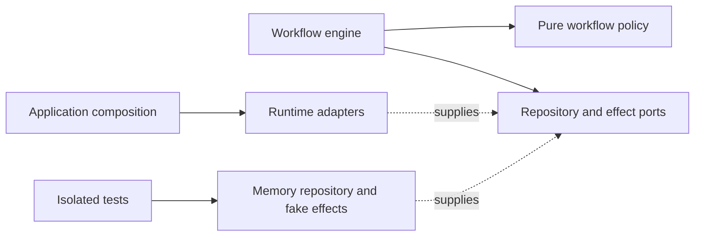

# Development boundaries

AgentLoom keeps workflow policy separate from the systems that execute it. A policy test should not need a database, provider login, GitHub account, HTTP listener or Docker daemon.

## Where changes belong

| Change                                        | Location                                            | Test approach                                            |
| --------------------------------------------- | --------------------------------------------------- | -------------------------------------------------------- |
| Approval, routing or review decision          | Pure shared policy                                  | Inputs and expected decisions, including blocked paths   |
| Workflow orchestration                        | `src/server/engine.ts`                              | In-memory repository and explicit fake effects           |
| Persistence contract                          | `src/server/ports/repository.ts`                    | Shared contract against memory and SQLite                |
| Provider, workspace, Git or validation effect | Server adapter behind an application-owned port     | Temporary local resources or injected external responses |
| Production wiring and defaults                | `src/server/app.ts`, `src/server/engine-runtime.ts` | App integration and adapter tests                        |
| UI behavior                                   | `src/client/`                                       | Isolated Playwright fixture                              |

The application owns its port types. They describe what workflow code needs; they do not import concrete adapters or derive their interfaces from SQLite classes. `Store` implements the repository contract, while test fixtures provide a separate in-memory implementation.

## Adding a feature

1. Express the decision as a pure function when possible. Test accepted, rejected and boundary cases with small values.
2. If the feature needs an external effect, define its smallest useful contract at the application boundary. Keep filesystem, subprocess, network and database operations in adapters.
3. Wire the real implementation at the composition root. Preserve runtime defaults for ordinary callers; tests provide explicit replacements.
4. Use the shared fixtures in `tests/helpers/`. Unexpected provider, Jev or GitHub activity must fail clearly instead of using a real account.
5. Add an adapter contract test when serialization, ordering, notifications or another observable adapter behavior changes. A fake and the real adapter must agree on the behavior the engine relies on.
6. Run the appropriate focused tests, then `npm run check`. Run `npm run test:ui` for workflow or UI interaction changes.

Do not add a second database abstraction or a dependency-injection framework for a new effect. Extend the relevant small port or introduce a focused one, and keep construction in the runtime composition layer.

## Enforced imports

ESLint rejects client imports of server code; shared policy imports of client/server adapters or Node I/O; concrete adapter imports from application ports; and direct adapter imports from the Engine. Pure utilities such as `node:path` and `node:crypto` are allowed. The checks also cover re-exports, literal dynamic imports and `require` calls.

These rules make accidental coupling visible during development. They do not replace review of runtime behavior or prevent arbitrary computed imports. See [Testing](TESTING.md) for fixture examples and commands.

## Runtime access

The production runner has the shell and Docker access authorized by the user. Planning and review roles preserve source by workflow policy; they are not isolated operating-system identities. Unit and integration fixtures use explicit fakes for external accounts. The standalone `compose.validation.yaml` uses empty provider keys and disposable volumes, and mounts neither host projects nor the Docker socket.

Approval, validation freshness and final publication rules remain product behavior. Dependency injection must not bypass those gates; fake-effect tests should exercise them directly.
